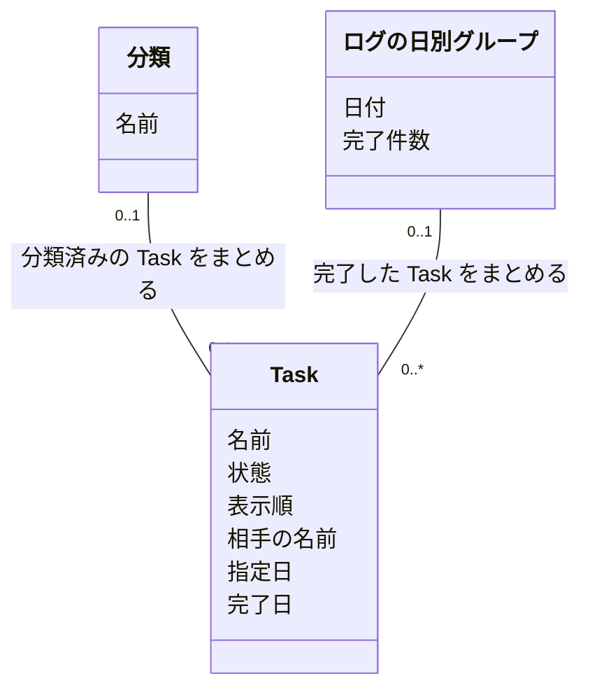
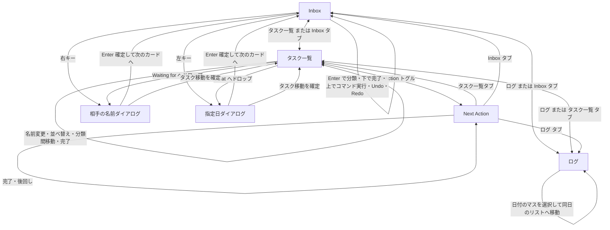

# Simple GTD の UI 設計

SPA の反復で採用中の差分は [Simple GTD SPA のタスク操作](../261121_spa_ui.md) を参照する。

Simple GTD は、個人のタスクを Markdown で管理する VS Code 拡張である。
サイドバーでは、未分類のアイテムをどこへ振り分け、次に何を実行し、何を終えたかをどう確認できるか。

- Inbox では、先頭のアイテムをキー操作で処理する。
- タスク一覧では、分類ごとにタスクを編集する。Next Action に切り替えると、今日の Do at と Next Actions を先頭から一件ずつ処理できる。
- ログでは、日別の完了件数から、その日に完了したタスクへ移動できる。

## タスク一覧

個人でタスクを管理する利用者が、振り分け、実行、振り返りを行う。根拠欄の節名は [IDEA.md](../../../IDEA.md) を指す。

| ID | 利用者 | 達成したいこと | 根拠 |
| --- | --- | --- | --- |
| T01 | 個人利用者 | Inbox の先頭アイテムを Next Actions に入れる | inbox処理 / Enter |
| T02 | 個人利用者 | Inbox の先頭アイテムを相手の名前とともに Waiting for に入れる | inbox処理 / 右キー |
| T03 | 個人利用者 | Inbox の先頭アイテムを指定日の Do at に入れるか、Someday を選ぶ | inbox処理 / 左キー |
| T04 | 個人利用者 | Inbox の先頭アイテムをその場で完了し、ログに残す | inbox処理 / 下キー、Concepts / log.md |
| T05 | 個人利用者 | Inbox の先頭アイテムをプロジェクト化するため、設定済みの VS Code コマンドを実行する | inbox処理 / 上キー、Concepts / プロジェクト化 |
| T06 | 個人利用者 | Inbox の処理を取り消し、取り消した処理をやり直す | inbox処理 / undo・redo |
| T07 | 個人利用者 | タスクを分類ごとに確認し、名前を変更する | Next Action提示 / タスク一覧 |
| T08 | 個人利用者 | タスクを並べ替え、別の分類へ移す。Waiting for や Do at へ移す際に必要な情報を指定する | Next Action提示 / タスク一覧 |
| T09 | 個人利用者 | タスク一覧のタスクを完了し、ログに残す | Next Action提示 / タスク一覧、Concepts / log.md |
| T10 | 個人利用者 | 今日の Do at と Next Actions を指定の順で一件ずつ確認し、先頭を完了するか後回しにする | Next Action提示 / タスク一覧、Concepts / log.md |
| T11 | 個人利用者 | 日別の完了件数を眺め、選んだ日に完了したタスクを確認する | ログ鑑賞 |

## オブジェクト関係図

Task は、Inbox での振り分けから完了後のログまで、利用者が扱う共通のオブジェクトである。状態は未分類・分類済み・完了のいずれかであり、状態に応じて表示する属性が変わる。



| Task の状態 | 表示する画面 | 状態に応じて使う属性 |
| --- | --- | --- |
| 未分類 | Inbox | Inbox 内の表示順 |
| 分類済み | タスク一覧、Next Action | 分類、分類内の表示順、Waiting for の相手の名前、Do at の指定日 |
| 完了 | ログ | 完了日 |

名前はすべての状態で表示する。分類済みの Task は Next Actions、Someday、Waiting for、Do at のいずれか一つに属する。ログの日別グループには、完了日が一致する Task が並び、件数がヒートマップのマスに対応する。

Markdown では Task の状態がファイルの配置に対応する。未分類は `inbox.md`、分類済みは `tasks.md` の分類見出しの下、完了は `log.md` の日付見出しの下に記録される。

## 画面遷移図

サイドバーのタブで Inbox、タスク一覧、ログを開く。タスク一覧の Next Action トグルは、分類別表示と先頭カード表示を切り替える。入力ダイアログは処理対象を示し、確定すると起点の画面へ戻る。



タスク一覧タブは分類別表示を開く設計とする。ダイアログは開いた画面へ戻る。Inbox の操作結果は、対応する Markdown ファイルに即座に反映する。

## 画面レイアウト

カードには処理対象の Task の名前を表示する。分類や状態を確認するための情報は、対象カードかその直近に置く。

### Inbox

重なったカードのうち先頭だけに内容を表示する。処理が確定すると次のカードを表示し、完了したアイテムはその日のログに載る。取り消しとやり直しの結果は、カードの並びと短い結果表示で確認できる。

```text
+--------------------------------------------------+
| [Inbox*] [Task list] [Log]                       |
|   +------------------------------------------+   |
| +------------------------------------------+ |   |
| | Book a dentist appointment               | |   |
| +------------------------------------------+-+   |
| Enter Next Actions    Right Waiting for          |
| Left  Do at / Someday Down  Done                 |
| Up    Project                                    |
| Ctrl/Cmd+Z Undo    Ctrl/Cmd+Shift+Z Redo         |
| Result: Moved to Next Actions                    |
+--------------------------------------------------+
```

### タスク一覧

分類見出しの下にタスクを並べる。カードの名前欄で編集し、ハンドルをつかんで同じ分類内または別の分類へ移す。完了したタスクは一覧から外れ、ログに載る。

```text
+--------------------------------------------------+
| [Inbox] [Task list*] [Log]   Next Action [Off]   |
| Next Actions                                     |
|   :: [ ] [Book a dentist appointment       ]     |
|   :: [ ] [Buy a replacement bulb           ]     |
| Someday                                          |
|   :: [ ] [Plan a weekend trip              ]     |
| Waiting for                                      |
|   :: [ ] [Confirm delivery                 ]     |
|          @David                                  |
| Do at                                            |
|   :: [ ] [Pick up parcel                   ]     |
|          @2026-11-21                       |
+--------------------------------------------------+
```

### Next Action

今日の Do at、Next Actions の順にカードを積み、先頭に名前、分類、該当する指定日を表示する。チェックボックスで完了し、下部のボタンで表示中の山の最下部へ送る。先頭が移動すると次のカードを表示する。

```text
+--------------------------------------------------+
| [Inbox] [Task list] [Log]    Next Action [On]    |
|   +------------------------------------------+   |
| +------------------------------------------+ |   |
| | Do at                                    | |   |
| | [ ] Pick up parcel                       | |   |
| | @2026-11-21                        | |   |
| +------------------------------------------+-+   |
|                [Move to bottom]                  |
+--------------------------------------------------+
```

### 相手の名前ダイアログ

対象名と移動先を表示し、相手の名前欄に自動でフォーカスする。確定すると Waiting for のカードに相手の名前を表示する。

```text
+-------------------------------------------+
| Waiting for                               |
| Confirm delivery                          |
| Person [David__________________________]  |
|                           [Confirm Enter] |
+-------------------------------------------+
```

### 指定日ダイアログ

対象名を表示し、カレンダーで日付を選択する。Inbox から開いた場合は Someday にも移せる。分類済みタスクは、カードの相手の名前や指定日をクリックして、分類や並び順を保ったまま更新できる。

```text
+-------------------------------------------+
| Do at                                     |
| Pick up parcel                            |
| Date [2026-11-21]                          |
| [Move to Someday] (from Inbox)             |
|                                 [Schedule] |
+-------------------------------------------+
```

### ログ

ヒートマップでは日別の件数を濃淡で表し、選択したマスの日付と件数を確認できるようにする。マスを選ぶと、同じ画面の下にある該当日の見出しへスクロールする。完了した Task がない日を選んだ場合は、その日付と0件を表示する。

```text
+--------------------------------------------------+
| [Inbox] [Task list] [Log*]                       |
| [.] [.] [o] [.] [#]  Less . o # More             |
| [o] [.] [.] [.] [.]                              |
| Selected: 2026-11-21 (2 completed)               |
|                                                  |
| 2026-11-21                                       |
|   - Pick up parcel                               |
|   - Book a dentist appointment                   |
| 2026-11-20                                       |
|   - Buy a replacement bulb                       |
+--------------------------------------------------+
```

## 要件との対応

各タスクは、画面上で対象を確認してから操作し、結果までたどれる。

| タスク | 対象と操作経路 | 完了の確認 |
| --- | --- | --- |
| T01 | Inbox アイテムを Enter で振り分ける | 次のカードが表示され、タスク一覧の Next Actions に入る |
| T02 | Inbox アイテムを右キーで処理し、相手の名前を確定する | Waiting for に相手の名前付きで表示される |
| T03 | Inbox アイテムを左キーで処理し、日付を選ぶか Someday を選ぶ | Do at または Someday に表示される |
| T04 | Inbox アイテムを下キーで完了する | 次のカードが表示され、ログに完了した Task が載る |
| T05 | Inbox アイテムから上キーで設定済みのコマンドを実行する | Inbox の結果欄でコマンド実行結果を確認する |
| T06 | Inbox で取り消しまたはやり直しを実行する | カードの並び、結果欄、関連する Markdown に結果が反映される |
| T07 | タスク一覧で分類を確認し、カードの名前欄を編集する | 分類の中に変更後の名前が表示される |
| T08 | タスク一覧でカードをドロップし、必要に応じてダイアログで確定する | 移動先にタスクと分類に応じた属性が表示される |
| T09 | タスク一覧で対象カードをチェックする | ログに完了した Task が載る |
| T10 | タスク一覧から Next Action をオンにして、先頭カードを完了または後回しにする | 山の先頭が更新され、完了した場合はログに載る |
| T11 | ログで完了日を選択する | 選択した日付の件数と完了した Taskを確認できる |

## 設計上の判断と未確定事項

タブを共通の入口とし、全体の件数が0の場合は該当画面に空の状態を表示する。相手の名前と指定日のダイアログは Inbox とタスク一覧で共用する。

- Next Action の「後回し」は現在の表示順に対する操作として扱う。表示順の保存期間と、再表示や日付変更時に並びをどう復元するかは未確定。
- 「今日」の判定に用いるタイムゾーン、ヒートマップの表示期間は未確定。
- プロジェクト用コマンドに渡す引数、成功後の Inbox アイテムの扱い、コマンドが行った変更を Undo・Redo の対象に含められるかは未確定。
- アイテム追加の入口は IDEA.md の interfaces に具体的な記述がないため未確定。GTD の一般フローにある削除と資料保存についても、拡張内での操作は未確定。
- IDEA.md の本文には分類が3つとあるが、具体例とキー操作に合わせて4分類を採用した。
