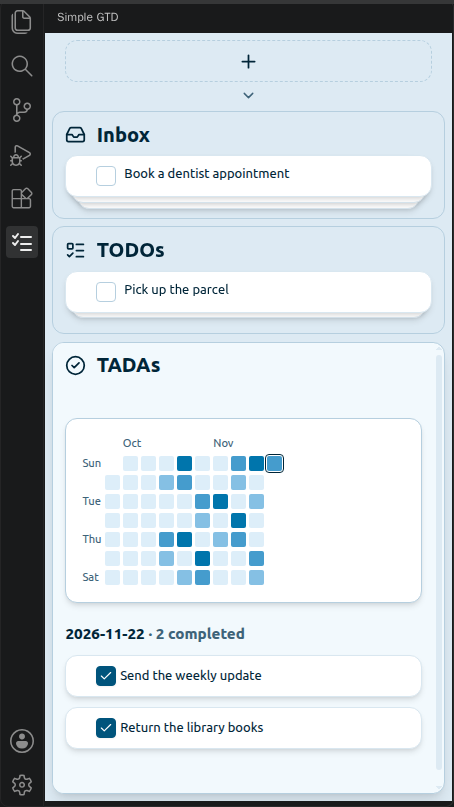

# Simple GTD

Simple GTD brings a Markdown-backed task inbox, a next-action list, and a completion calendar into the VS Code sidebar. Capture a task while you work, decide what to do with it later, and keep the records alongside the rest of your workspace.

## Get started

1. Open a folder in VS Code and select **Simple GTD** in the Activity Bar.
2. Click **+** above **Inbox**, type a task, and press **Enter**. The button stays available while you work in **TODOs** or **TADAs**.
3. Open **Inbox** to process the top card. With focus outside an input, press **Enter** to move it to **Next Actions**. Click its checkbox when the task is complete.

## Manage tasks in the sidebar

The sidebar keeps all three panels visible. Click a closed panel's header or preview to open it and use its controls.

- **Inbox** shows the next task to process. Use the calendar or person icon to schedule it or mark it as waiting for someone.
- **TODOs** opens the **Next Actions** stack. Use the arrow above the stack to move its top card to the bottom. Switch to **All** to see tasks grouped by category, edit their names, reorder them, or drag them between lists.
- **TADAs** shows completed work on a heatmap. Select a day to see the tasks you finished.

## Your tasks are Markdown files

The extension stores tasks in `_tasks/` inside the workspace folder. You can edit the files directly. Tasks use plain Markdown bullets, and scheduled tasks use a date in the form `@YYYY-MM-DD`.

| File | Contents |
| --- | --- |
| `_tasks/inbox.md` | Tasks waiting to be processed |
| `_tasks/tasks.md` | Next Actions, Waiting for, Do at, and Someday |
| `_tasks/log.md` | Completed tasks grouped by day |

In a multi-root workspace, use **Simple GTD: Select Workspace Folder** from the Command Palette to choose where tasks are stored.

## Optional Project integration

Set `simpleGtd.projectCommand` to a VS Code command ID to use the **Project** button in Inbox. The extension passes the task name and the selected workspace folder URI to that command.

Requires VS Code Desktop 1.85 or later.
